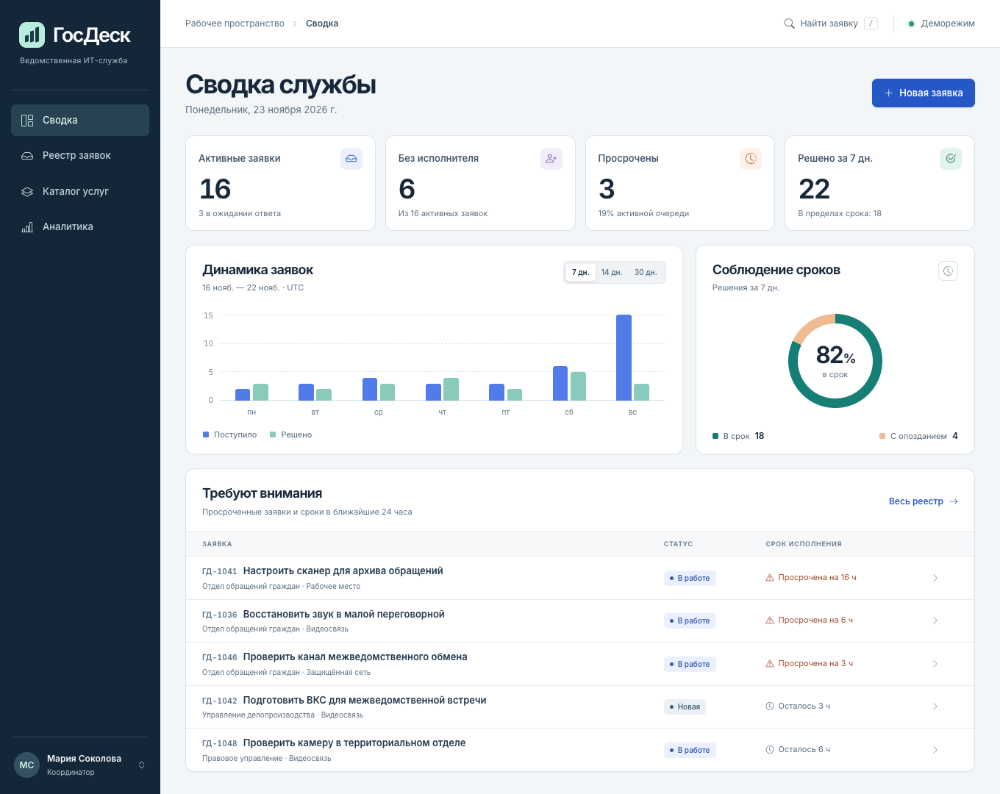

# ГосДеск

ГосДеск — служба ИТ-поддержки для сотрудников государственных учреждений. Через неё можно запросить доступ к ведомственному реестру, восстановить работу электронной подписи или подготовить видеосвязь для межведомственного совещания. Сотрудник видит, кто ведёт его обращение, когда истекает срок и какое решение предложил специалист.



## Запуск демо

Вам понадобится **Node.js 24.x** с npm. В каталоге проекта выполните одну команду.

```sh
npm run demo
```

Откройте [ГосДеск на своём компьютере](http://127.0.0.1:3000). Сервер создаст SQLite-базу с шестью услугами и 48 вымышленными обращениями. При первом входе откроется сводка координатора. Даты примеров отсчитываются от первого запуска, а изменения сохраняются между запусками. Приложение использует встроенные модули Node.js, шрифты и иконки поставляются вместе с исходниками.

### Одна заявка в трёх ролях

1. Нажмите **Деморежим** и выберите Анну Левину. В **Каталоге услуг** откройте «Электронная подпись» и зарегистрируйте заявку. Для высокого приоритета срок составит 12 часов. Запомните номер карточки.
2. Переключитесь на координатора Марию Соколову. Нажмите `/`, найдите карточку по номеру и назначьте Илью Морозова.
3. В профиле Ильи откройте **Реестр заявок → Назначены мне**. Запросите уточнение или нажмите **Предложить решение** и опишите результат.
4. Вернитесь в профиль Анны. В карточке можно подтвердить решение и закрыть обращение либо вернуть его в работу с пояснением.

## Возможности

| Раздел | Что можно сделать |
| --- | --- |
| Сводка службы | Перейти к просроченным и неназначенным заявкам, проверить динамику поступления и решения обращений, увидеть ближайшие сроки |
| Реестр | Найти заявку по номеру, теме, заявителю или подразделению. Совместить фильтры по услуге, статусу, приоритету и сроку. Скачать отобранные строки в CSV |
| Каталог услуг | Подать заявку на ИТ-услугу с заранее выбранной категорией и увидеть срок при смене приоритета |
| Карточка | Назначить исполнителя, запросить уточнение, обсудить обращение, предложить решение и подтвердить результат. Все изменения остаются в хронологии |
| Аналитика | Сравнить поступления и решения за 7, 14 или 30 дней, посмотреть долю решений в срок, нагрузку по услугам и обращения подразделений |

**Область доступа** определяется сервером. Сотруднику видны собственные обращения. Специалисту доступны неназначенная очередь, его назначения и личные обращения. Координатор работает со всем реестром. Эти же правила применяются к поиску, отчётам и выгрузкам.

**Срок исполнения** назначается при регистрации. Для обычного приоритета он составляет от 12 до 48 календарных часов в зависимости от услуги. Высокий приоритет сокращает срок вдвое, низкий увеличивает вдвое. Уточнения и переназначения сохраняют исходный срок. Полные правила приведены в [описании архитектуры](docs/architecture.md).

## Рабочий режим

Для собственных данных создайте пользователей. Команда запросит пароль длиной от 12 символов со скрытым вводом. Пример создаёт координатора.

```sh
npm run user:add -- --name "Координатор службы" --email coordinator@example.org --unit "Управление цифрового развития" --role coordinator
```

Той же командой создайте исполнителя с ролью `specialist` и заявителя с ролью `employee`. Затем запустите сервер.

```sh
npm start
```

Рабочий режим открывает форму входа и использует отдельную базу. По умолчанию сервер слушает локальный интерфейс. Для развёртывания за HTTPS-прокси задайте внешний адрес в `GOSDESK_ORIGIN` и включите `GOSDESK_SECURE_COOKIE=1`.

| Переменная | Назначение | По умолчанию |
| --- | --- | --- |
| `HOST` | Адрес прослушивания | `127.0.0.1` |
| `PORT` | Порт HTTP | `3000` |
| `GOSDESK_DB` | Путь к файлу SQLite для сервера и команды создания пользователей | `var/gosdesk.sqlite` или `var/demo.sqlite` |
| `GOSDESK_ORIGIN` | Точный внешний origin для проверки запросов из браузера, например `https://desk.example.org` | Схема соединения и заголовок Host |
| `GOSDESK_SECURE_COOKIE` | Атрибут Secure у сессионной cookie | Выключен, значение `1` включает |

### Docker

```sh
docker build -t gosdesk .
docker run --rm -p 127.0.0.1:3000:3000 -v gosdesk-demo:/app/var gosdesk node bin/server.mjs --demo
```

Для рабочего режима создайте профили в отдельном томе и запустите образ с его стандартной командой.

```sh
docker run --rm -it -v gosdesk-data:/app/var gosdesk node bin/user-add.mjs --name "Координатор службы" --email coordinator@example.org --unit "Управление ИТ" --role coordinator
docker run --rm -p 127.0.0.1:3000:3000 -v gosdesk-data:/app/var gosdesk
```

## Проверка и разработка

```sh
npm test
```

Тесты поднимают временные HTTP-серверы и SQLite-базы. Они проверяют права трёх ролей, регистрацию и смену статусов, сроки и границы суток, повторную отправку формы, конфликт версий, поиск, отчёты, CSV, вход и сохранность данных после перезапуска. GitHub Actions запускает тесты на Linux и Windows, а отдельное задание собирает Docker-образ и проверяет API контейнера.

| Каталог | Содержимое |
| --- | --- |
| `bin/` | Запуск сервера и создание пользователей |
| `src/` | HTTP API, сессии, правила доступа, запросы к SQLite и отчёты |
| `public/` | Адаптивный интерфейс на JavaScript, CSS и локальные шрифты |
| `tests/` | Интеграционные тесты HTTP, базы и командной строки |
| `docs/` | Схема приложения, правила процессов, описание API и снимок интерфейса |

Контракт HTTP с примерами запросов приведён в [справочнике API](docs/api.md). Схема хранения, переходы между статусами и расчёт показателей описаны в [архитектуре проекта](docs/architecture.md).

Шрифт Inter и пиктограммы Bootstrap Icons включены с лицензиями авторов. [Inter](public/assets/licenses/inter.txt) · [Bootstrap Icons](public/assets/licenses/bootstrap-icons.txt)
