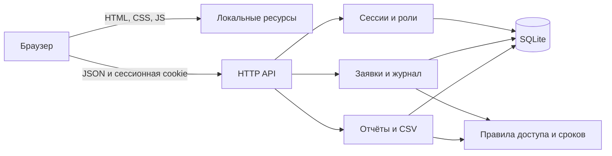

# Архитектура ГосДеска

Однопроцессное приложение обслуживает интерфейс и JSON API с одного адреса. Браузер отвечает за представление. Сервер определяет область видимости, вычисляет срок исполнения и разрешённые действия. SQLite хранит рабочие данные на диске.

## Жизненный цикл заявки

| Исходный статус | Команда | Кто выполняет | Результат |
| --- | --- | --- | --- |
| Новая | Назначить или взять в работу | Координатор назначает специалиста. Специалист может взять свободную заявку себе | В работе |
| В работе | Запросить уточнение | Исполнитель или координатор | Ожидает ответа. В журнал записывается вопрос |
| Ожидает ответа | Вернуть в работу | Исполнитель, координатор или заявитель | В работе. Заявитель прикладывает ответ |
| В работе / Ожидает ответа | Предложить решение | Исполнитель или координатор | Решена. Текст решения обязателен |
| Решена | Подтвердить и закрыть | Заявитель или координатор | Закрыта |
| Решена | Вернуть в работу | Заявитель или координатор | В работе. В журнал записывается причина возврата |

Координатор может переназначить активную заявку другому специалисту. Уточнение сохраняет статус ожидания при переназначении. Комментарий добавляется в любую видимую незакрытую заявку и сохраняет её статус.

## Данные и согласованность

- **Пользователь** хранит имя, подразделение, почту, роль и хеш пароля. Демонстрационные профили создаются отдельно.
- **Услуга** определяет название, описание и базовое количество часов до срока исполнения.
- **Заявка** связывает заявителя, услугу и исполнителя. В карточке хранятся исходный срок, статус, отметки регистрации, решения и закрытия, а также версия.
- **Событие** содержит автора, тип действия, пояснение и время. Регистрация, назначение, уточнение, комментарий, решение и закрытие дополняют историю.
- **Сессия** связывает хеш случайного токена с пользователем и временем истечения.
- **Метаданные базы** фиксируют режим. Версия схемы хранится в SQLite `user_version`. Преобразования схемы применяются внутри транзакции.

Команда изменения читает карточку в транзакции `BEGIN IMMEDIATE`, сравнивает версию клиента, проверяет действие, записывает событие и повышает версию. При конкурирующей записи клиент получает `409 version_conflict` и может загрузить последние изменения.

При регистрации браузер создаёт ключ для конкретной формы. Повтор запроса с тем же ключом, пользователем и содержимым возвращает существующую карточку. Другой набор полей для использованного ключа даёт `409 request_key_conflict`. Уникальный индекс защищает от одновременного создания дубликатов.

## Сроки и отчёты

Срок равен времени регистрации плюс базовая длительность услуги с поправкой на приоритет. Расчёт ведётся в календарных часах, включая выходные. При ожидании ответа часы продолжают идти. Возврат после решения сохраняет исходный срок.

| Услуга | Низкий | Обычный | Высокий |
| --- | ---: | ---: | ---: |
| Документооборот | 48 ч | 24 ч | 12 ч |
| Доступ к системам | 96 ч | 48 ч | 24 ч |
| Электронная подпись | 48 ч | 24 ч | 12 ч |
| Защищённая сеть | 24 ч | 12 ч | 6 ч |
| Рабочее место | 96 ч | 48 ч | 24 ч |
| Видеосвязь | 24 ч | 12 ч | 6 ч |

Момент решения, равный сроку, считается своевременным. Активная заявка становится просроченной, как только текущее время превышает срок. На сводку попадают до пяти заявок с самым ранним сроком, включая просроченные и те, чей срок наступит в течение суток.

Периоды 7, 14 и 30 дней охватывают сегодня и предыдущие календарные дни по UTC. Объём поступления считается по времени регистрации. Количество решений считается по событиям «Предложено решение». После возврата в работу повторное решение учитывается как отдельное событие. Доля в срок равна отношению своевременных решений ко всем решениям в периоде. При отсутствии решений интерфейс показывает прочерк. Открытая очередь и нагрузка по услугам отражают текущее состояние при любом отчётном периоде.

Область видимости для реестра, отчёта и CSV вычисляет одна функция. История в отчёте относится к карточкам, доступным пользователю в момент запроса.

## Хранение и эксплуатация

Сервер использует внешние ключи SQLite, режим WAL и ожидание освобождения блокировки до пяти секунд. Для резервной копии работающей базы используйте механизм SQLite Backup. Для файловой копии остановите сервер и скопируйте каталог данных целиком.

Пароль обрабатывается scrypt с индивидуальной случайной солью. Сессия живёт восемь часов. Сервер хранит SHA-256 хеш токена и выдаёт cookie с HttpOnly и SameSite=Strict. В рабочем режиме за HTTPS-прокси поддерживается Secure. После десяти неудачных попыток входа с адреса сервер ограничивает новые попытки до конца 15-минутного окна. За прокси адресом для этого счётчика будет TCP-адрес прокси.

Деморежим предназначен для знакомства с системой. Сервис выдаёт в нём одну из трёх демонстрационных ролей по выбору посетителя. Для рабочих обращений используется режим с учётными записями и собственной базой.
